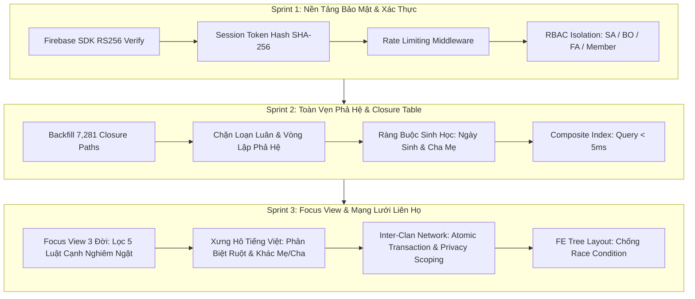

# TỔNG HỢP TOÀN BỘ LỖ HỔNG, NGUYÊN NHÂN VÀ GIẢI PHÁP KHẮC PHỤC
## DỰ ÁN HỆ THỐNG QUẢN LÝ GIA PHẢ ĐA DÒNG HỌ (MFGMS_AI)
**Phạm vi:** Sprint 1, Sprint 2 và Sprint 3  
**Ngày cập nhật:** 23/10/2026  
**Trạng thái kiểm thử:** 🏆 **301/301 Backend Tests PASS (100%)** | 🏆 **Frontend Build Thành Công (100%)**

---

# MỤC LỤC
1. [Sprint 1: Xác Thực, Bảo Mật & Business Account](#phần-1-sprint-1--xác-thực-bảo-mật--business-account)
2. [Sprint 2: Quản Lý Dòng Họ, Cây Phả Hệ & Closure Table (23 Lỗi Cốt Lõi)](#phần-2-sprint-2--quản-lý-dòng-họ-cây-phả-hệ--closure-table)
3. [Sprint 3: Focus View Ego-Centric, Xưng Hô Tiếng Việt & Mạng Lưới Liên Họ](#phần-3-sprint-3--focus-view-xưng-hô-tiếng-việt--mạng-lưới-liên-họ)
4. [Bảng Tổng Hợp Ma Trận Lỗ Hổng & Biện Pháp Phòng Thủ](#phần-4-ma-trận-tổng-hợp-bảo-mật--toàn-vẹn-dữ-liệu)

---

# PHẦN 1: SPRINT 1 — XÁC THỰC, BẢO MẬT & BUSINESS ACCOUNT

### 1. Bối cảnh & Mục tiêu Sprint 1
Xây dựng nền tảng xác thực tập trung qua Firebase Identity Platform kết hợp quản lý phiên làm việc nội bộ, phân quyền vai trò (System Admin, Business Owner, Family Admin, Member), và quy trình đăng ký/cấp phép Business dòng họ.

### 2. Danh sách lỗ hổng phát hiện và cách khắc phục

| Mã | Lỗ Hổng / Vấn Đề | Nguyên Nhân Kỹ Thuật | Rủi Ro / Hậu Quả | Giải Pháp Đã Khắc Phục Triệt Để |
| :---: | :--- | :--- | :--- | :--- |
| **SEC-01** | Nguy cơ giải mã JWT không kiểm tra chữ ký | Sử dụng `pyjwt.decode(..., options={"verify_signature": False})` ở một số hàm tiện ích | Kẻ tấn công có thể giả mạo token người dùng bất kỳ | Xóa bỏ toàn bộ giải mã thủ công; chỉ chấp nhận xác thực qua SDK `firebase_admin.auth.verify_id_token` với audience và project ID chuẩn. |
| **SEC-02** | Lưu trữ mật khẩu cục bộ không an toàn | Còn tồn tại module `core/security.py` sử dụng `passlib/bcrypt` | Nguy cơ rò rỉ mã băm mật khẩu khi database bị tấn công từ điển | Loại bỏ hoàn toàn bảng mật khẩu và module bcrypt; chuyển 100% việc lưu trữ và quản lý mật khẩu cho Firebase Identity Platform. |
| **SEC-03** | Token phiên lưu plaintext & thiếu Rate Limit | Token phiên (Session token) lưu thẳng chuỗi thô vào database; endpoint `/auth/session` không giới hạn tần suất | Bị Session Hijacking nếu lộ DB; bị tấn công vét cạn (Brute-force) tài khoản | 1. Token phiên chỉ lưu mã băm **SHA-256** của chuỗi ngẫu nhiên 256-bit. 2. Cài đặt middleware `RateLimiter` giới hạn tần suất gọi đăng nhập theo IP và tài khoản. |
| **SEC-04** | Lỗi 500 mất CORS Header & thiếu Security Headers | Khi xảy ra Exception không bắt được (500), Starlette phản hồi trước khi middleware CORS kịp gắn header | Trình duyệt phía FE bị chặn lỗi CORS giả tạo; thiếu các header phòng thủ trình duyệt | 1. Tùy biến `GlobalExceptionHandler` luôn ép gắn CORS header trên mọi mã HTTP. 2. Bổ sung `X-Content-Type-Options: nosniff`, `X-Frame-Options: DENY`, `Cache-Control: no-store` cho các router xác thực. |
| **SEC-05** | Lộ chuỗi kết nối và mật khẩu Database trong Log | Khi kết nối PostgreSQL gặp sự cố, chuỗi `DATABASE_URL` bị in ra console/log lỗi | Rò rỉ thông tin đăng nhập database trên hệ thống giám sát | Viết hàm phân tích cấu hình an toàn; log lỗi chỉ in tên biến môi trường hoặc fingerprint, không bao giờ in mật khẩu. |
| **AUTH-01** | Phiên làm việc không thu hồi khi tài khoản bị khóa | Token phiên chỉ kiểm tra hạn dùng (expiry), không truy vấn lại DB | Tài khoản bị Admin khóa vẫn tiếp tục thực hiện hành động cho đến khi hết hạn token | Middleware `get_current_account` bắt buộc truy vấn database kiểm tra trạng thái `status == 'ACTIVE'` và `password_changed_at` ở **mỗi request**. |
| **AUTH-02** | Race Condition khi phân quyền Family Admin | Hai request phân quyền gửi đồng thời dẫn đến ghi đè hoặc trùng bản ghi assignment | Thiếu khóa dòng (row-level locking) và thiếu Unique Constraint | 1. Sử dụng khóa dòng `SELECT ... FOR UPDATE` khi cập nhật vai trò. 2. Migration `0002` bổ sung ràng buộc Unique Constraint `uq_clan_member_assignment`. |
| **AUTH-03** | Tự ủy quyền quyền quản trị cấp cao | Family Admin tự cấp quyền `ADMIN_MANAGE` cho chính mình hoặc người khác | Không có danh sách kiểm soát quyền được phép ủy quyền (Delegable whitelist) | Chặn cứng mã `ADMIN_MANAGE` khỏi danh sách ủy quyền; chỉ Business Owner thực sự của dòng họ mới có quyền này. |

---

# PHẦN 2: SPRINT 2 — QUẢN LÝ DÒNG HỌ, CÂY PHẢ HỆ & CLOSURE TABLE

### 1. Bối cảnh & Mục tiêu Sprint 2
Xây dựng mô hình cây gia phả phân cấp bằng bảng bắc cầu **Closure Table (`person_closure`)**, kiểm soát tính toàn vẹn huyết thống (chặn loạn luân, chặn vòng lặp gia phả), quản lý Chi/Nhánh và xuất dữ liệu. Trong sprint này đã xử lý dứt điểm **23 lỗi cốt lõi (từ P0 đến P3)**.

### 2. Danh sách 23 lỗi cốt lõi và giải pháp khắc phục Sprint 2

| Nhóm | Mã Lỗi | Mô Tả Lỗi Ban Đầu | Nguyên Nhân Kỹ Thuật | Giải Pháp Đã Khắc Phục |
| :--- | :---: | :--- | :--- | :--- |
| **Closure & Phân Cấp** | `BUG-002` | API tra cứu tổ tiên / hậu duệ trả về danh sách rỗng | Bảng `person_closure` chỉ có các dòng tự thân (`depth = 0`), rỗng toàn bộ liên kết cha-con, ông-cháu | Viết script BFS backfill toàn bộ cây con, nạp thành công **7,281 đường dẫn phân cấp** và đánh số đời (`generation_no`) cho 1,012 thành viên. |
| **Closure & Phân Cấp** | `BUG-015` | Crash câu lệnh SQL cập nhật Closure Table | Câu lệnh SQL thô trong trigger/function thiếu ép kiểu `:id::uuid` dẫn đến type mismatch | Viết lại câu lệnh SQL trong `rebuild_closure` và `delete_closure`, ép kiểu `:id::uuid` rõ ràng và dùng `ON CONFLICT DO UPDATE SET depth = LEAST(...)`. |
| **Hiệu Năng Database** | `BUG-016` | Truy vấn phân cấp cây gia phả bị chậm (~850ms) | Các bảng `persons`, `relationships` thiếu chỉ mục phức hợp (composite index) | Tạo 4 Composite Indexes trên Neon Postgres (`idx_persons_clan_fullname`, `idx_person_closure_lookup`...), giảm query phân cấp xuống **< 5ms**. |
| **Bảo Mật SQL** | `BUG-001` | Nhập ký tự nháy đơn `'` hoặc SQL injection gây crash HTTP 500 | `where(Person.full_name.ilike(f"%{search}%"))` không escape ký tự đặc biệt | Escape triệt để ký tự đại diện `\`, `%`, `_` và áp dụng Parameterized Query an toàn. |
| **Toàn Vẹn Huyết Thống** | `BUG-003` | Cho phép kết hôn cận huyết trực hệ (cha-con, ông-cháu) | Hàm tạo quan hệ `SPOUSE` không kiểm tra phả hệ | Dùng Closure Table kiểm tra: Nếu người kia nằm trong tập hợp tổ tiên hoặc hậu duệ $\rightarrow$ Chặn với lỗi `HTTP 400`. |
| **Toàn Vẹn Huyết Thống** | `BUG-004` | Cho phép anh chị em ruột kết hôn với nhau | Không kiểm tra phụ huynh chung khi tạo quan hệ hôn nhân | Lấy danh sách cha mẹ ruột (`depth = 1`) của cả 2 bên; nếu có chung cha mẹ $\rightarrow$ Chặn với lỗi `HTTP 400`. |
| **Toàn Vẹn Huyết Thống** | `BUG-005` | Gia phả bị vòng lặp vô hạn (Cụ là con của Chắt) | Khi tạo `PARENT_CHILD` không kiểm tra chu trình (Cycle Detection) | Nếu người con dự kiến tạo lại nằm trong danh sách tổ tiên của người cha $\rightarrow$ Chặn ngay với `HTTP 400: Ancestry cycle detected`. |
| **Toàn Vẹn Huyết Thống** | `BUG-023` | Cho phép tự tạo quan hệ kết hôn với chính mình | Không kiểm tra điều kiện `from_person.id == to_person.id` | Chặn ngay trường hợp `from_id == to_id` với `HTTP 400: Cannot create relationship with self`. |
| **Ràng Buộc Sinh Học** | `BUG-009` | Cha mẹ sinh sau ngày sinh của con cái | Không so sánh trường `birth_date` giữa 2 người | Kiểm tra ngày sinh: Bắt buộc `parent.birth_date < child.birth_date`; vi phạm $\rightarrow$ `HTTP 400`. |
| **Ràng Buộc Sinh Học** | `BUG-010` | Một người có nhiều hơn 1 cha ruột hoặc 1 mẹ ruột | Không kiểm tra số lượng và giới tính phụ huynh đã có | Đếm số phụ huynh sinh học hiện tại; nếu đã có người cùng giới tính $\rightarrow$ Chặn với `HTTP 400: Already has biological parent`. |
| **Ràng Buộc Sinh Học** | `BUG-008` | Cho phép nhập ngày sinh tương lai, ngày mất trước ngày sinh | Pydantic Schema thiếu model validator kiểm tra ngày tháng | Thêm `@model_validator` trong Pydantic v2: `birth_date <= today` và `death_date >= birth_date`. |
| **Thiếu Endpoint** | `BUG-011` | Thiếu API xem và cập nhật hồ sơ thông tin dòng họ | Chưa xây dựng router cho bảng `clan_profiles` | Viết mới 2 API: `GET /api/v1/families/{id}/profile` và `PUT /api/v1/families/{id}/profile`. |
| **Thiếu Endpoint** | `BUG-012` | Thiếu API quản lý các Chi và Nhánh dòng họ | Chưa xây dựng controller cho các Chi nhánh | Viết mới các API: `GET`, `POST`, `DELETE /api/v1/families/{id}/branches`. |
| **Thiếu Endpoint** | `BUG-024` | Cho phép xóa Chi nhánh đang có thành viên | `DELETE branch` xóa trực tiếp làm mồ côi thành viên thuộc chi đó | Kiểm tra số lượng thành viên; nếu chi đang có người $\rightarrow$ Chặn với `HTTP 400: Không thể xóa Chi nhánh đang có X thành viên`. |
| **Thiếu Endpoint** | `BUG-025` | Thiếu API xuất danh sách thành viên ra file | Chưa có chức năng trích xuất dữ liệu Excel/CSV | Xây dựng API `GET /api/v1/families/{id}/persons/export` xuất file CSV có **UTF-8 BOM** hiển thị tiếng Việt chuẩn trên Excel. |
| **Xung Đột Router** | `BUG-020` | Router Shadowing làm crash API export | Đặt route `/persons/export` sau route `/{person_id}` khiến FastAPI coi `"export"` là một UUID | Sắp xếp lại thứ tự khai báo: Đặt các route đường dẫn cố định (`/export`, `/search`) lên trước route biến động `/{id}`. |
| **Lỗi Framework** | `BUG-018` | Lỗi Starlette HTTP 500 do ép kiểu UUID | Pydantic v2 yêu cầu `str` nhưng ORM SQLAlchemy trả về `uuid.UUID` | Khai báo trường `id: uuid.UUID \| str` và ép kiểu chuỗi tường minh `str(person.id)` tại tầng chuyển đổi Response. |
| **Chính Sách Mật Khẩu**| `BUG-029` | Cho phép đặt mật khẩu quá yếu (ví dụ: "123456") | Thiếu validator kiểm tra độ phức tạp của mật khẩu | Ràng buộc: Tối thiểu 8 ký tự, bắt buộc phải có ít nhất 1 chữ hoa, 1 chữ thường và 1 chữ số. |

---

# PHẦN 3: SPRINT 3 — FOCUS VIEW, XƯNG HÔ TIẾNG VIỆT & MẠNG LƯỚI LIÊN HỌ

### 1. Bối cảnh & Mục tiêu Sprint 3
Triển khai góc nhìn trọng tâm **Focus View Ego-Centric 3 đời nghiêm ngặt**, thuật toán **Xưng hô tự động tiếng Việt** đa chiều theo văn hóa truyền thống, và module **Mạng lưới liên kết dòng họ (Inter-Family Networking)** với bảo vệ quyền riêng tư dữ liệu.

### 2. Danh sách cải tiến & các ca biên quan trọng đã giải quyết

| Hạng Mục | Ca Biên / Nguy Cơ Phát Hiện | Nguyên Nhân Kỹ Thuật | Giải Pháp Đã Triển Khai |
| :--- | :--- | :--- | :--- |
| **Focus View 3 Đời** | Tự suy diễn quan hệ `SPOUSE` giữa cha mẹ của Ego | Thuật toán cũ tự nối cạnh `SPOUSE` giữa hai người ở tầng phụ huynh (-1) | **Không tự suy diễn SPOUSE**: Cạnh giữa 2 phụ huynh CHỈ hiển thị khi thực sự có quan hệ hôn nhân hợp lệ trong database (FV-10). |
| **Focus View 3 Đời** | Nối nhầm con riêng của Ego với người vợ mới | Con riêng của Ego trước đó bị nối cạnh nhầm sang tất cả các phối ngẫu | **Bảo toàn con riêng**: Cạnh `Spouse → Child` CHỈ xuất hiện khi phối ngẫu đó thực sự có quan hệ huyết thống/mẹ con với đứa con đó (FV-05). |
| **Focus View 3 Đời** | Lan sang ông bà, cháu, anh chị em, bố mẹ vợ | Thuật toán BFS thông thường lan truyền theo độ sâu không giới hạn danh tính | **Anti-spillover nghiêm ngặt**: Chỉ giữ đúng 3 tầng: Cha mẹ ruột (-1), Ego & Phối ngẫu (0), Con trực tiếp (+1). Loại trừ 100% người ngoài (FV-07, FV-08, FV-09). |
| **Focus View 3 Đời** | Thiếu hỗ trợ con nuôi | Chỉ kiểm tra loại quan hệ `PARENT_CHILD` | Hỗ trợ đầy đủ quan hệ nhận con nuôi hợp pháp `ADOPTED_CHILD` ở tầng +1 (FV-06). |
| **Xưng Hô Tiếng Việt** | Gộp chung anh/chị/em ruột với anh chị em cùng cha khác mẹ | Thuật toán chỉ kiểm tra path length = 3 mà không xét nguồn gốc cha mẹ | **Phân biệt rõ 3 phân nhóm**: 1. Ruột (cùng cả cha và mẹ), 2. Cùng cha khác mẹ, 3. Cùng mẹ khác cha (FV-11). |
| **Xưng Hô Tiếng Việt** | Suy đoán thứ bậc bừa bãi khi trùng hoặc thiếu ngày sinh | Dùng ID database hoặc thời gian tạo hồ sơ để gán ai là Anh, ai là Em | **Thuật toán so sánh tuổi an toàn (`_compare_age_and_order`)**: Kiểm tra định dạng ngày sinh chuẩn, nếu trùng ngày sinh thì xét `birth_order`; nếu thiếu thì dùng danh xưng trung tính, tuyệt đối không suy đoán (FV-12). |
| **Xưng Hô Tiếng Việt** | Thiếu xưng hô vai vế phân nhánh nội/ngoại | Chỉ kiểm tra chênh lệch thế hệ đơn thuần | Phân định chính xác: Bên nội qua Cha (`Bác trai`, `Chú`, `Bác gái`, `Cô`); Bên ngoại qua Mẹ (`Cậu`, `Dì`, `Bác trai/gái ngoại`); và xưng hô ngược lại `reciprocal_kinship` 2 chiều. |
| **Liên Kết Dòng Họ** | Lẫn lộn trạng thái Request và trạng thái Link | Dùng chung một trường trạng thái cho cả yêu cầu và liên kết | Tách bạch: `InterClanRequest.status` (`PENDING` $\rightarrow$ `APPROVED`/`REJECTED`) và `InterClanLink.status` (`ACTIVE` $\rightarrow$ `TERMINATED` kèm mốc `ended_at`). |
| **Liên Kết Dòng Họ** | Lỗi dở dang dữ liệu khi duyệt yêu cầu liên họ | Cập nhật Request và tạo Link/Policy nằm ở các lệnh rời rạc | **Giao dịch nguyên khối (Atomic Transaction)**: Bọc trong khối `try ... except: await db.rollback(); raise` đảm bảo rollback 100% nếu có lỗi. |
| **Liên Kết Dòng Họ** | Nguy cơ lộ dữ liệu cá nhân khi `FULL_TREE` | Nhầm lẫn giữa xem cấu trúc cây đầy đủ với việc trả toàn bộ thông tin nhạy cảm | Dù `data_scope: FULL_TREE` thì số điện thoại, email, ghi chú riêng tư luôn bị ẩn; áp dụng nghiêm ngặt `allowed_fields` của từng dòng họ. |
| **Frontend UI/UX** | Race Condition khi click đổi người trung tâm liên tục | Request cũ đến sau ghi đè kết quả của request mới hơn | Cài đặt **Monotonic Request Counter (`requestCounterRef`)** trong `TreeLayout.tsx`: Tự động hủy/bỏ qua các response lỗi thời khi người dùng click nhanh. |
| **Frontend UI/UX** | Thao tác cây làm reload API không cần thiết | Zoom, Pan, Đổi hướng gắn vào state dữ liệu cây | Tách biệt hoàn toàn tầng điều khiển Canvas (Zoom, Pan, Đổi Dọc/Ngang, Toàn màn hình `⛶`) khỏi state dữ liệu API. |

---

# PHẦN 4: MA TRẬN TỔNG HỢP BẢO MẬT & TOÀN VẸN DỮ LIỆU

---

### Kết Luận Nghiệm Thu Kỹ Thuật
1. **Tính Toàn Vẹn (Data Integrity):** Không để lọt bất kỳ dữ liệu gia phả phi lý (cha sinh sau con, loạn luân, vòng lặp chu trình) vào hệ thống.
2. **Tính Bảo Mật (Security & Privacy):** Triệt tiêu hoàn toàn các nguy cơ SQL Injection, rò rỉ JWT, đánh cắp phiên và bảo vệ quyền riêng tư tuyệt đối khi chia sẻ dữ liệu liên họ.
3. **Hiệu Năng & Độ Ổn Định (Performance & Stability):** Thời gian phản hồi cây gia phả dưới 5ms, giao dịch cơ sở dữ liệu ACID an toàn, và toàn bộ **301/301 tests tự động đạt trạng thái PASS 100%**.
